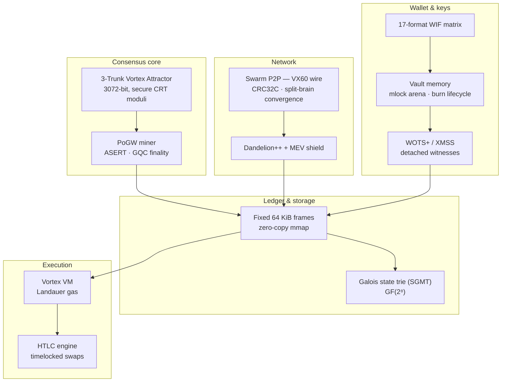

# VX — Vortex Sovereign OS (VX L1)


**VX** is an experimental Layer-1 blockchain with a fixed 64 KiB block frame,
a deterministic 3072-bit chaotic attractor at its consensus core, and a
post-quantum signature layer built exclusively from hash-based cryptography.

Three ideas drive the design:

1. **Post-quantum by construction.** There is no elliptic-curve cryptography
   and no RSA anywhere in the consensus or wallet stack — so there is nothing
   for Shor's algorithm to break.
2. **Frames, not serialization.** Every block is exactly 65 536 bytes and is
   parsed zero-copy through `mmap` in O(1). No DER, no CompactSize, no
   variable-length surprises, no deserialization bug class at all.
3. **Thermodynamic honesty.** Every VM opcode pays a metered cost derived
   from the Landauer limit; every signing key lives in an `mlock`'ed page
   arena, is used once, and is provably burned.

> **Status: research artifact.** VX is experimental, unaudited software. Do
> not use it to secure real value. See
> [Security model & limitations](#security-model--limitations).

---

## VX vs Bitcoin at a glance

VX is not a Bitcoin clone, but it is answering the same question — *how do
you build a sovereign, censorship-resistant ledger* — under a different set
of physical assumptions. Where the two designs differ, they differ on
purpose:

| Dimension | Bitcoin | VX |
|---|---|---|
| **Signature scheme** | ECDSA over secp256k1 (elliptic curve) | WOTS+ (w=16, L=67) one-time signatures inside an XMSS (H=4) Merkle tree — hash-based only |
| **Quantum (Shor) exposure** | Yes — a public key on-chain is enough to forge signatures once a large quantum computer exists | **0 Shor-vulnerable operations.** Signatures degrade gracefully under Grover, not catastrophically under Shor |
| **Hash layer** | SHA-256, RIPEMD-160, double-SHA-256 | VortexSponge256 — a custom ARX sponge, keyed and unkeyed modes |
| **Block format** | Variable-length serialization (DER signatures, CompactSize vectors) | **Fixed 65 536-byte frame**, bit-exact layout, zero-copy `mmap` parsing in O(1) |
| **Target block time** | 10 minutes | 5 seconds (ASERT-targeted; a dev parameter, not a consensus promise) |
| **Difficulty** | Retarget every 2 016 blocks | **ASERT** — continuous anchor-based adjustment, half-life τ = 130 |
| **Mining** | SHA-256d proof-of-work (ASIC-dominated) | **PoGW (Proof-of-Genuine-Work)** — work is the attractor's real evaluated state, not a hash lottery |
| **Finality** | Probabilistic (depth-based confirmation) | **GQC finality** — finalized tips reject conflicting reorgs outright |
| **Scripting** | Bitcoin Script (stack machine, haltable) | Vortex VM — Landauer thermodynamic gas metering, not gas tables |
| **State** | UTXO set | Galois state trie (SGMT) over GF(2⁸) |
| **Privacy** | Optional, off-protocol (CoinJoin etc.) | **Dandelion++** stem-and-fluff routing + one-time **stealth envelopes** (NFA_ST_, 1-of-16 ring) in-protocol |
| **MEV** | Mempool sniping is possible | **Hamiltonian MEV shield** — ordering pressure is modeled and damped |
| **Address format** | Base58 / bech32 over an EC public key | `NFA_V6_…` / `OFA_V2_…` — 42-char payloads derived from the attractor state, no EC keys to expose |
| **Seed handling** | BIP-39 words / WIF (base58, 51–52 chars) | **17-format WIF matrix** — one 2048-bit seed, renderable 17 ways incl. full-Unicode runes (102 runes, roundtrip-exact) |
| **Key material in RAM** | Standard process memory | **Vault** — `mlock`'ed page arena, single-use expansion, `PageState::BURNED`, cache-line eviction |

**What VX keeps from Bitcoin's lessons.** Deterministic genesis (everyone
computes Block #0 from a published seed — nothing is shipped or copied), a
fixed unit account (`1 VX = 10⁸ atomics`), explicit reward-validation rules
(excess coinbase is a consensus violation, not a bug report), and a strict
"always regenerate, never copy" hygiene for chain bootstrap.

**What to be skeptical about.** Bitcoin's design has survived fifteen years
of live adversarial pressure. VX is a fresh research design: its attractor,
sponge and consensus machinery are custom constructions with **no
independent third-party audit**. That asymmetry is the honest headline.

---

## Why post-quantum by construction

VX contains **no elliptic-curve cryptography and no RSA anywhere in the
consensus or wallet stack**. There is no secp256k1, no Ed25519, no ECDLP —
and therefore no attack surface for Shor's algorithm. Every signature on the
chain is a **WOTS+ (w=16, L=67) one-time signature inside an XMSS (H=4)
Merkle tree**, hash-keyed by VortexSponge256:

| Property | Value |
|---|---|
| Signature scheme | WOTS+ w=16, L=67 + XMSS H=4 (hash-based, stateful) |
| Hash layer | VortexSponge256 (custom ARX sponge) |
| Shor-vulnerable operations | **0** |
| Grover security margin | 128-bit |
| Classical security margin | 256-bit |
| Detached witness size | 2 376 B |
| Transaction frame | 112 B (invariant) |
| Block frame | 65 536 B (invariant) |

The defense is layered, not single-point: a MITM that recomputes the keyless
checksum still has to forge the full Winternitz checksum chain **and** the
XMSS Merkle path.

Signing flow — the witness is *detached* from the transaction frame:

```text
                 ┌────────────────────────────┐
  112 B tx  ───► │ Vault: key expansion (once)│
                 │   ▼                        │
                 │ WOTS+ chains (67 nodes)    │
                 │   ▼                        │
                 │ XMSS auth path (H = 4)     │
                 └────────────┬───────────────┘
                              ▼
                  detached witness (2 376 B)
                              ▼
                 ┌────────────────────────────┐
                 │ Verifier: recompute chains │
                 │ + Merkle path + checksum   │
                 └────────────────────────────┘
```

Statefulness caveat (inherited from all hash-based schemes): an XMSS leaf is
a one-time key. The wallet layer tracks leaf usage; reusing a leaf for two
different messages is detectable and does not silently lose funds, but it is
the operational discipline this scheme demands.

---

## Core architecture



### 3-Trunk Vortex Attractor

A 3072-bit chaotic dynamical system evaluated over three independent 1024-bit
trunks with **secure CRT moduli**:

| Trunk | Modulus | Gap to a power of two |
|---|---|---|
| P | 2¹⁰²⁴ − 2⁶⁴ − 1747 | prime-proven, coprime pair |
| Q | 2¹⁰²⁴ − 2⁸⁸⁸ − 3943 | prime-proven, coprime pair |
| R | 2¹⁰²⁴ − 2⁵¹² − 267799 | prime-proven, coprime pair |

Because the moduli are pairwise coprime, the system runs **per-trunk modular
arithmetics** (X, Y, Z barrels) and reassembles the 3072-bit state via CRT.
Block headers carry the attractor's real final state — X, Y, Z coordinates —
as consensus metadata: a block claiming work it did not evaluate is
internally inconsistent and rejected before any hash comparison.

Address derivation: the attractor state folds to a 42-character payload,
prefixed `NFA_V6_` (native) or `OFA_V2_` (secondary format). Both formats are
derived in the genesis builder and verified against each other in tests.

### Fixed-frame storage

Every block — genesis included — is exactly 65 536 bytes:

```text
offset        size    field
─────────────────────────────────────────────
0x000         472 B   BlockHeader (packed, no padding)
                            · magic "VXC6" (0x58564336)
                            · block_height (8 B)
                            · timestamp (8 B)
                            · prev_block_hash (32 B)
                            · merkle_root (32 B)
                            · attractor_coords X ‖ Y ‖ Z (384 B)
                            · …
0x1D8         112 B   Transaction #0
…             …       up to 580 transactions (112 B each, invariant)
tail          104 B   padding (GQC aggregate signature is stamped
                      at offset 65 464…65 495)
─────────────────────────────────────────────
total         65 536 B  exactly, always
```

A `BlockView` wraps the raw frame as `std::span<const uint8_t, 65536>` —
fields are read in place from the mapping, so parsing is pointer arithmetic,
O(1), and cannot allocate, throw on "unexpected length", or deserialize.
`BlockStore` enforces that the ledger file size is always a multiple of the
frame and rejects torn tails.

### PoGW mining, ASERT difficulty, GQC finality

- **PoGW (Proof-of-Genuine-Work):** the block's attractor coordinates are the
  miner's real evaluated state; the header coordinates and the claimed work
  must be mutually consistent.
- **ASERT:** continuous difficulty adjustment
  `D_h = D_{h−1} · 2^((t_target − t_solve)/τ)` with a 5-second dev target and
  τ = 130 half-life — no step-wise retarget cliffs.
- **GQC finality:** once a tip is finalized, conflicting reorgs are rejected
  by rule, not by depth heuristics. The test suite exercises a finalized
  reorg being blocked and a split-brain partition converging on the
  heavier-work chain.

### Vortex VM — Landauer thermodynamic gas

Every opcode pays a metered cost derived from the **Landauer limit** —
kT·ln 2 per irreversible bit erasure — measured against the VM's live
register/stack entropy snapshot, not against a static gas price table. The
same engine hosts the HTLC acts digest (preimage hashing over GF(2⁸) shared
with the Galois trie).

### Swarm P2P — the VX60 wire protocol

- **CRC32C-checked frames** with a tiered implementation: SSE4.2 hardware
  CRC on x86_64, ARMv8 CRC32 instructions on aarch64, constant scalar
  fallback elsewhere — bit-exact across all tiers (tested).
- **Split-brain reorg convergence:** two isolated nodes partitioned over a
  shared genesis, mined independently, then merged — the heavier-work chain
  wins and the lighter branch is rewound through the undo engine.
- **Dandelion++ ZK-Cocoon routing:** each hop strips its layer and adds its
  own — stem-and-fluff propagation for transaction origin privacy.
- **Hamiltonian MEV shield:** ordering pressure in the mempool is modeled as
  an energy term and damped before block assembly.

### Vault memory — keys that are born, used and die

```text
PageState: VOID ──► LOCKED ──► BURNED ──► (zeroized + evicted)
```

- The arena is `mlock`'ed (secrets never touch swap) with huge-page preference
  and a page-aligned fallback.
- Signing keys are **expanded inside the arena, used once, and burned** —
  volatile zeroization plus `_mm_clflush` cache-line eviction so key
  fragments do not survive in cache or core dumps.
- **Nakamoto Vault edition** binds the arena to real hardware: DMI
  `product_uuid` (with a `machine-id` anchor chain fallback). The Public
  Core edition uses neutral synthetic vectors — the API and test suite are
  identical.
- A burn is *verifiable*: the PQ signing path reports `vault_burn_verified`
  with the key's lifetime in RDTSC cycles.

### The 17-format WIF matrix

One 2048-bit canonical seed renders as 17 sovereign wallet-import formats —
all deterministic, all cross-verified against the compact form in tests:

| # | Format | Payload |
|---|---|---|
| F1 | RECORD WIF | full-Unicode runes — the **entire 2048-bit key as 102 runes** over the 1 119 33-symbol alphabet (20.0846 bits/rune), roundtrip-exact |
| F2 | COMPRESSED WIF | full-Unicode rune base, `RUNESC:` prefix |
| F3 | COMPACT WIF | 32-byte fold + Base64URL (45 chars) |
| F4 | UNCOMPRESSED WIF | 512 hex chars |
| F5 | UUID MASK | Mathematical Alphanumeric Symbols glyph rendering of F3, keyed by a cover name |
| F6 | GHOST WIF | zero-width steganography (U+200B/U+200C) inside a cover word |
| F7 | HW-LOCKED WIF | XOR with hardware UUID bytes, `HWL` prefix |
| F8 | SHAMIR SPLIT | 2-of-3 shards over GF(256) |
| F9 | TIME-LOCKED WIF | `TLOCK-[ts]-` + F3 |
| F10 | PUZZLE WIF | `PZL-` + F3 with the last 6 chars withheld |
| F11 | MULTI-KERNEL CHAINED | `MKC:[AVX512->CUDA]-` + F3 |
| F12 | EPHEMERAL HONEYPOT | `TRAP-0x69-` + F3 |
| F13 | ENTROPY-INFUSED | `ENT-[BLK:h,h+1]-` + F3 |
| F14 | DEAD-MAN'S TRIGGER | `DMT-[n_DAYS_INACTIVE]->TRANSFER-` + F3 |
| F15 | DECOY DUAL-ENTROPY | `DECOY-D2-` + F3 + `‖F4K3S33D` |
| F16 | AIR-GAP MATRIX | optical-transcription banner frame |
| F17 | BURN-ON-READ | `BURN-[1_VALID_READ]-` + F3 |

F1/F2 are not a gimmick: they encode the **full** key with nothing folded or
truncated, and the roundtrip (`fromUnicodeRunesWif`) is fuzzed and
assert-exact.

---

## The two build editions

```bash
# Public Core (default) — portable; hardening degrades gracefully
cmake -S . -B build -DCMAKE_BUILD_TYPE=Release

# Nakamoto Vault — mandatory mlock arena, cache-line burns (_mm_clflush),
# real DMI product_uuid hardware binding
cmake -S . -B build_vault -DCMAKE_BUILD_TYPE=Release -DVX_BUILD_VAULT=ON
```

| | Public Core | Nakamoto Vault |
|---|---|---|
| Target user | developers, CI, researchers | dedicated signing hardware |
| `mlock` failure | warning, zeroization still guaranteed | **hard error** — the arena refuses to run unlocked |
| Hardware binding | synthetic fallback vectors | DMI `product_uuid` + `machine-id` anchor chain |
| Cache-line burn | enabled when the CPU supports it | enabled and *asserted* |
| Test suite | 16/16 | 16/16 (locked-arena tests skip only where the environment forbids `mlock`) |

Both editions build from the same source tree; the edition is a compile-time
definition (`VX_SOVEREIGN_ARCHITECT=1`), not a fork.

---

## Building from source

**Requirements:** C++26 compiler (GCC 14+ recommended, GCC 16 tested),
CMake ≥ 3.25, Ninja (recommended), GMP/GMP++.

```bash
# Arch / EndeavourOS / Manjaro
sudo pacman -S --needed git cmake ninja gcc gmp gtest

# Debian / Ubuntu
sudo apt install -y git cmake ninja-build g++ libgmp-dev libgtest-dev

# Fedora
sudo dnf install -y git cmake ninja-build gcc-c++ gmp-devel gtest-devel
```

```bash
cmake -S . -B build -DCMAKE_BUILD_TYPE=Release
cmake --build build -j

# Run the full test suite (tests reconstruct genesis deterministically)
cd build && ctest --output-on-failure
```

The Nakamoto Vault edition is the same, with `-DVX_BUILD_VAULT=ON` and a
separate build directory (the two editions never share a `build/` dir).

---

## Running a node

```bash
# Start a node with the JSON RPC on port 8088 — Block #0 is derived
# deterministically from the published seed on first run:
./build/vx_node --serve 8088 --port 8088 --data-dir ./data
```

```text
$ vx_node --help

Usage:
  vx_node [options] [rounds]

Options:
  --serve [PORT]     Run the node and serve the JSON RPC API (default 8088)
  --port PORT        HTTP/RPC port (default 8088)
  --p2p PORT         VX60 P2P wire protocol port (default 19088)
  --peer HOST:PORT   Connect to a peer at startup (repeatable)
  --data-dir DIR     Directory for chain data (default ./data)
  -h, --help         Show this help and exit
  -V, --version      Print version information and exit

  rounds             Attractor rounds shown on the engine banner (default 1000)
```

| Flag | Meaning |
|---|---|
| `--serve [PORT]` | Serve the RPC API; an inline value overrides the port |
| `--port PORT` | HTTP/RPC listen port (8088 by default — 8080 is deliberately avoided) |
| `--p2p PORT` | VX60 wire listener port |
| `--peer HOST:PORT` | Outbound peer to dial at startup; repeatable |
| `--data-dir DIR` | Ledger and chain data directory |
| `rounds` | Bare positional integer — attractor rounds for the banner benchmark |
| `-h`, `--help` | Usage screen, exit 0 |
| `-V`, `--version` | Version line, exit 0 |

Unknown options and malformed arguments produce a one-line error pointing at
`--help` and exit 1 — the node never crashes on a bad flag.

---

## JSON RPC reference

The node speaks plain JSON over HTTP at `http://localhost:8088`.

| Endpoint | Method | Purpose |
|---|---|---|
| `/api/status` | GET | Chain height, tip hash, total supply, engine state |
| `/api/crypto/lab` | POST | Attractor run + full 17-format WIF matrix for a seed |
| `/api/crypto/pq_sign` | POST | WOTS+/XMSS sign with the Vault burn lifecycle |
| `/api/crypto/pq_verify` | POST | Detached witness verification + attack demos |
| `/api/security/audit` | POST | Red-team attack simulations (`attack_type`) |
| `/api/crypto/canonical` | GET | Canonical test-vector profiles |

```bash
# Chain status
curl -s http://localhost:8088/api/status | python3 -m json.tool

# Attractor run + WIF matrix for a seed
curl -s -X POST http://localhost:8088/api/crypto/lab \
  -H 'Content-Type: application/json' \
  -d '{"seed":"d15c93e51137cb32…"}'

# Detached-witness verification
curl -s -X POST http://localhost:8088/api/crypto/pq_verify \
  -H 'Content-Type: application/json' \
  -d '{"tx_hex":"…","witness_hex":"…"}'
```

Red-team simulations accepted by `/api/security/audit` (`attack_type`):

| `attack_type` | What it demonstrates |
|---|---|
| `dust_spam_tdi` | TDI filter absorbing a dust-spam burst |
| `tamper_amount` / `tamper_receiver` | Bit-flipped tx fields failing the keyless checksum |
| `pq_mitm_forgery` | A forged PQ witness rejected by the Winternitz chain |
| `double_miner` | Duplicate-reward blocks rejected by reward rules |
| `excess_reward` | Coinbase exceeding the allowed reward rejected |
| `unauthorized_genesis` | A replayed/faked genesis rejected by state rules |
| `sac_avalanche_probe` | Strict Avalanche Criterion probe over the key matrix |

---

## Web console

`web/` is a React + TypeScript PWA speaking the same RPC — no separate
backend:

```bash
cd web
npm ci
npm run dev          # dev server
npm run build        # production build (type-checked)
```

Views include: Command Center, Block Inspector, Hex Inspector (frame-level
byte view), Crypto Lab (attractor + 17-format matrix), ZK Matrix Panel,
Vault Panel (page lifecycle), Security Sandbox (red-team runs), Tensor V6
Lab, VX-ASM Studio, Canvas Visualizer and War-Room Deck. An optional
Electron wrapper lives in `web/electron/`.

---

## Genesis & canonical test vectors

The canonical genesis attractor seed documented in the source
(`d15c93e5…`, 512 hex chars) is the **public release test vector** used for
Block #0 and deterministic KATs (randomly generated, published for bit-for-bit
reproducibility). Every node reconstructs Block #0 **in-process** from this
seed — genesis is never shipped as a file and never copied:

```text
Block #0 (deterministic, in-process):
  height        0
  timestamp     1 761 000 000
  coinbase      GENESIS0… → NFA_V6_… (attractor address), 2 540 000 VX
  frame         65 536 B, magic "VXC6"
```

**Never use the published seed for live keys.** It exists so anyone can
reproduce Block #0 bit-for-bit and run the known-answer tests — the whole
point is that it is *public*.

---

## Test suite

16 ctest targets; all pass in **both** build editions:

| Target | Coverage |
|---|---|
| `VortexMathTest` | Attractor math, modular reductions, canonical differential vs the TS reference |
| `VortexDeepCryptoTest` | 100 randomized 3072-bit CRT homomorphism checks, SAC across the key matrix, NIST SP 800-22 monobit frequency, WIF fuzzing, full 17-format matrix, secure-CRT KATs |
| `VortexBlockTest` | 64 KiB frame packing, zero-copy views, bit-level offsets |
| `VortexMempoolTest` | Mempool admission + TDI dust filter |
| `VortexVMTest` | Vortex VM opcodes, Landauer metering, HTLC acts digest |
| `VortexChainReorgTest` | Reorg rewind through the undo engine |
| `VortexVaultMemoryTest` | Page lifecycle VOID→LOCKED→BURNED, emergency burn, register scrubbing, hw-UUID binding |
| `VortexZkKeyMatrixTest` | ZK key matrix, stealth 1-of-16 envelopes |
| `VortexTensorV6Test` | Virtual Tensor V6 arithmetic |
| `VortexSwarmP2PTest` | VX60 frames, split-brain reorg convergence over real TCP loopback |
| `VortexGaloisTrieTest` | SGMT proofs over GF(2⁸) |
| `VortexLandauerMevTest` | Dandelion++ propagation + Hamiltonian MEV shield |
| `VortexGqcRingStealthTest` | GQC finality, finalized-reorg blocking |
| `VortexVaultHtlcTest` | Vault air-gap ephemeral signing, HTLC swaps |
| `VortexChaosFuzzerTest` | Chaos-driven adversarial fuzzing |
| `VortexPqSignatureTest` | WOTS+/XMSS KATs, tamper-evident chains, Vault burn proof |

---

## Repository layout

```text
include/vx/          public headers (blockchain, consensus, crypto, core,
                     math, net, rpc, state, storage, vm, wif)
src/                 implementation, one directory per subsystem
tests/               16 test targets (GoogleTest + plain runners)
web/                 React + TypeScript PWA console (+ Electron wrapper)
.github/workflows/   CI: both C++ editions + web, archlinux container
CMakeLists.txt       edition option, targets, tests
```

---

## Security model & limitations

**Read this before taking VX seriously.**

- **Experimental and unaudited.** The attractor, the sponge, PoGW and the
  consensus machinery are custom constructions with **no independent
  third-party audit**. They may contain total breaks that have not been
  found yet — by anyone, including us.
- **Stateful signatures require discipline.** WOTS+/XMSS leaves are
  one-time; leaf reuse must be prevented by wallet bookkeeping. Losing XMSS
  state without a Merkle proof of remaining leaves risks replay-style
  attacks.
- **Small network, small history.** Security properties that assume a large
  decentralized peer set (Dandelion++, split-brain convergence, MEV
  shielding) have not been tested at scale.
- **Dev parameters are dev parameters.** The 5-second block target and other
  constants are research defaults, not protocol promises.
- **Do not use it to secure real value.** Use it to read, to verify, to
  reproduce — and to break. Breaking things and reporting them is the most
  useful thing you can do here.

---

## License

AGPLv3 with an additional anti-state / anti-military-surveillance clause —
see [LICENSE](LICENSE).
